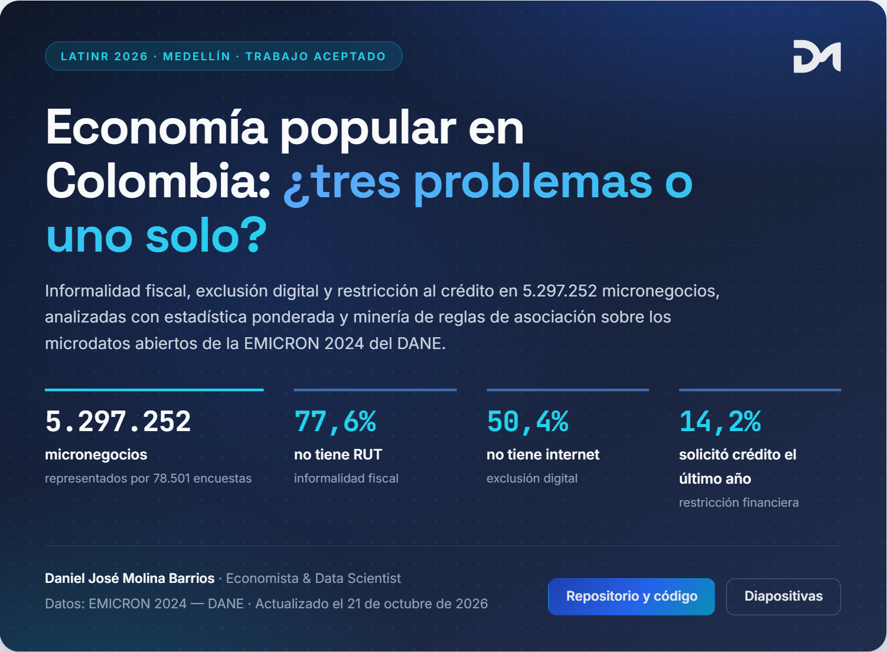
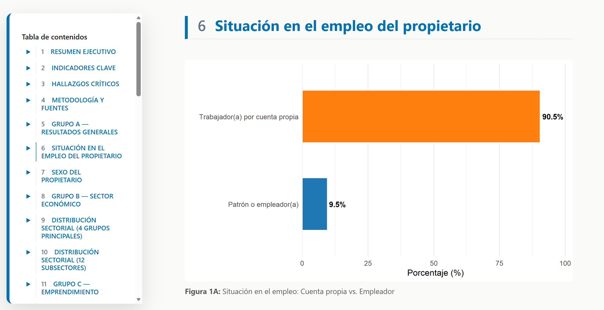
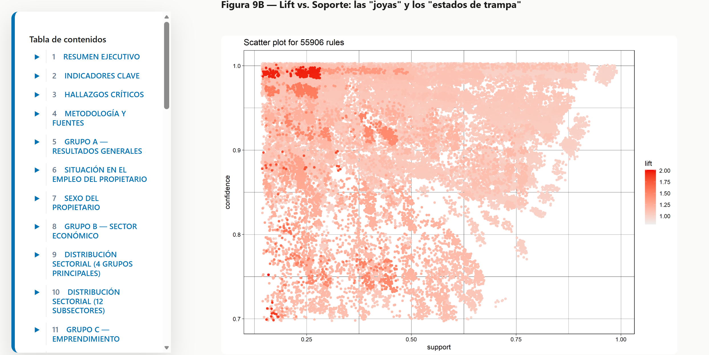

# EMICRON 2024 — Reglas de asociación y caracterización de la economía popular en Colombia

[](https://www.r-project.org/)
[](https://quarto.org/)
[](renv.lock)
[](tests/validar_resultados.R)
[](LICENSE)
[](https://dmetrics1.github.io/micronegocios-colombia-2024/)

**Pipeline reproducible en R que toma los microdatos abiertos de la Encuesta de Micronegocios (EMICRON) 2024 del DANE —78.501 encuestas que representan 5,3 millones de micronegocios— y responde una pregunta: ¿la informalidad fiscal, la exclusión digital y la restricción al crédito son tres problemas o uno solo?**

> **📊 Reporte →** [dmetrics1.github.io/micronegocios-colombia-2024](https://dmetrics1.github.io/micronegocios-colombia-2024/)
> **🎤 Diapositivas de la charla →** […/presentacion/](https://dmetrics1.github.io/micronegocios-colombia-2024/presentacion/)
> **🎓 Trabajo aceptado en [LatinR 2026](https://latin-r.com/)** (presentación de 15 min · Medellín, noviembre de 2026): *"Minería de Reglas de Asociación y Caracterización de la Economía Popular en Colombia: Un Enfoque de Datos Abiertos Basado en R y Quarto"* · [resumen y respuesta a los revisores](paper/)

---

## Índice

1. [Qué hace y por qué importa](#-qué-hace-y-por-qué-importa)
2. [Hallazgos clave](#-hallazgos-clave)
3. [Capturas](#-capturas-del-reporte)
4. [Datos](#-datos)
5. [Metodología](#-metodología)
6. [Requisitos e instalación](#-requisitos-e-instalación)
7. [Reproducir los resultados](#-reproducir-los-resultados)
8. [Verificar](#-verificar)
9. [Estructura del repositorio](#-estructura-del-repositorio)
10. [Limitaciones](#-limitaciones)
11. [Documentación](#-documentación)
12. [Cómo citar](#-cómo-citar)
13. [Licencia, créditos y contacto](#-licencia-créditos-y-contacto)

---

## 🎯 Qué hace y por qué importa

Los micronegocios son la forma de empleo más extendida de la economía popular colombiana, y el diagnóstico habitual los describe con indicadores sueltos: tantos sin RUT, tantos sin internet, tantos sin crédito. Este proyecto mira **qué características aparecen juntas** usando minería de reglas de asociación (algoritmo Apriori, paquete `arules`) sobre los microdatos oficiales, con las medidas ponderadas por el factor de expansión del diseño muestral.

Lo que puedes reutilizar:

- Un pipeline completo de **consolidación y depuración de la EMICRON** (11 módulos CSV → una base analítica con etiquetas del diccionario DANE).
- Una función de **tabulados ponderados** que reproduce el boletín técnico oficial (70 cuadros).
- Un ejemplo de **Apriori con factores de expansión**: cómo recalcular soporte, confianza y lift ponderados con `arules::support(..., weighted = TRUE)`.
- Un **análisis de robustez** (rejilla de umbrales, muestral vs. ponderado) y una **segmentación** transparente en tres grupos.
- Unas diapositivas donde **ninguna cifra está escrita a mano** (todo se calcula desde `output/tablas/`) y un reporte Quarto cuyas tablas de resultados se leen de esas mismas salidas.

## 🔑 Hallazgos clave

| Indicador (ponderado) | Valor | Fuente |
|---|---|---|
| 🏛️ Sin RUT | **77,6 %** (94,0 % en zonas rurales) | `F1_RUT.csv` · boletín DANE |
| 📵 Sin internet | **50,4 %** | `G9_Uso_Internet.csv` |
| 💳 Solicitó crédito el último año | **14,2 %** | `H2_Solicito_Credito.csv` |
| 👤 Cuenta propia · unipersonal | **90,5 %** · **82,3 %** | `A1_…` · `E2_…` |
| ♀️ Propietaria mujer | **35,4 %** (29,5 % rural) | `A2_…` · boletín DANE |

**Reglas de asociación** (55.906 reglas no redundantes · soporte ≥ 15 % · confianza ≥ 70 % · medidas ponderadas por `F_EXP`):

- `{sin computador ni tableta, sin celular de negocio, sin transferencias} ⇒ {sin internet en el local}` — **confianza 99,6 %, soporte 27,6 %, lift 1,90**. La exclusión digital es acumulada: cuando falta una herramienta, faltan todas. Estable en las 16 combinaciones de umbrales evaluadas.
- `{usa celular, acepta transferencias} ⇒ {internet en el local}` — **lift ponderado 1,87**. Las TIC co-ocurren como sistema.
- `{tiene RUT, usa celular} ⇒ {acepta transferencias}` — **lift 2,01**, el más alto del análisis. Con soporte ≥ 5 %, las combinaciones de internet, transferencias y local fijo se asocian con tener RUT (confianza 77 %, lift 3,4): la formalización no es independiente de la digitalización.

**Segmentación** (internet × RUT, grupos excluyentes y exhaustivos): **Excluidos 46,2 %** · **En transición 35,7 %** · **Integrados 18,2 %**. Los grupos se diferencian en variables que no los definen: aceptan transferencias el 5,7 % de los excluidos frente al 86,9 % de los integrados.

**Robustez:** al ponderar por `F_EXP`, el 99 % de las reglas se mantiene y la correlación entre lifts es 0,996.

> Son asociaciones en datos de corte transversal: describen co-ocurrencias, no efectos causales.

## 📸 Capturas del reporte

<table>
  <tr>
    <td width="50%"></td>
    <td width="50%"></td>
  </tr>
  <tr>
    <td colspan="2"></td>
  </tr>
</table>

## 📊 Datos

| | |
|---|---|
| **Fuente** | [Encuesta de Micronegocios (EMICRON) 2024 — DANE](https://microdatos.dane.gov.co) · microdatos anonimizados de uso público |
| **Universo representado** | 5.297.252 micronegocios (factor de expansión `F_EXP`) |
| **Muestra** | 78.501 negocios · 11 módulos (77.202 registros completos en las 30 variables de Apriori) |
| **Período de referencia** | 2024 |
| **Incluidos en el repo** | `data/raw/2024/` (11 CSV, ~70 MB, tal como los publica el DANE) · `data/processed/` (RDS intermedios) · `data/reference/` (cifras del boletín oficial usadas para validar) |

Los microdatos son del DANE y se incluyen sin modificaciones para que el análisis se reproduzca sin pasos manuales; consulta las condiciones de uso en el portal de microdatos del DANE.

## 🔬 Metodología

```
data/raw/2024 (11 CSV)
  → [01] consolidar módulos (data.table, llave DIRECTORIO + SECUENCIA)
  → [02] depurar: códigos 98/99 → NA · etiquetas del diccionario · índices sintéticos · personal ocupado
  → [03] 70 cuadros ponderados por F_EXP            → output/tablas/boletin/
  → [04][04b] EDA y gráficos de los cuadros           → output/figuras/
  → [05] Apriori (arules): 30 variables, supp ≥ 0,15, conf ≥ 0,70, maxlen 4,
         sin redundantes, medidas ponderadas          → output/tablas/06*…10*
  → [06] segmentación internet × RUT + perfil         → output/tablas/11*
  → [07] robustez: rejilla de umbrales, muestral vs ponderado, reglas hacia RUT → output/tablas/12*
  → REPORTE_WIDE_PRO_2024.qmd (Quarto)               → REPORTE_WIDE_PRO_2024.html
```

- **Ponderación.** `apriori()` trata cada registro con igual peso. `F_EXP` se asigna como `transactionInfo(trans)$weight` y se recalculan soporte, confianza y lift ponderados (`medidas_ponderadas()` en `scripts/00_config.R`). El reporte muestra ambas versiones.
- **Índices.** Formalización (0–5: RUT, Cámara de Comercio, registro contable, salud y pensión, declara renta) y digital (0–4: internet, redes sociales, página web, celular). Definidos en `scripts/02_limpiar.R`.
- **Validación.** 10 indicadores clave contrastados con el boletín técnico del DANE: 9 coinciden con menos de 0,1 p.p.; la participación de la agricultura difiere en 1,06 p.p. (ver [docs/validacion/](docs/validacion/) y [tests/](tests/)).
- Detalle completo en el [reporte](https://dmetrics1.github.io/micronegocios-colombia-2024/) y en la [respuesta a los revisores de LatinR](paper/RESPUESTA_REVISORES.md).

## 🧰 Requisitos e instalación

- **R ≥ 4.5** (desarrollado con 4.5.2) y, para el reporte, **Quarto ≥ 1.8**. RStudio es opcional.
- Paquetes: `data.table`, `arules`, `arulesViz`, `ggplot2`, `patchwork`, `scales` (pipeline); `knitr`, `rmarkdown` (reporte). Las versiones exactas están en [`renv.lock`](renv.lock).
- ~1 GB de espacio para los paquetes y unos 3 minutos de ejecución.

```r
# 1. Clona el repositorio y ábrelo (emicron.Rproj) o fija el directorio de trabajo en la raíz
# 2. Restaura las versiones exactas de los paquetes (la primera vez tarda varios minutos):
install.packages("renv")
renv::restore()
```

## 🚀 Reproducir los resultados

```r
source("main.R")   # ejecuta scripts/01 → 07; ~2 minutos; regenera output/
```

```bash
quarto render REPORTE_WIDE_PRO_2024.qmd --to html     # reporte
cd presentacion && Rscript build.R                     # cifras y figuras de las diapositivas
```

`main.R` comprueba antes de empezar que está en la raíz del proyecto, que los 11 CSV existen y que los paquetes están instalados, y se detiene con un mensaje claro si falta algo. `output/` no se versiona: se regenera por completo con `main.R`.

### Ejemplo mínimo

```r
source("scripts/00_config.R")
trans  <- readRDS("data/processed/transacciones_apriori.rds")      # generado por scripts/05_apriori.R
reglas <- arules::apriori(trans, parameter = list(supp = 0.20, conf = 0.80, minlen = 2, maxlen = 3))
reglas <- reglas[!arules::is.redundant(reglas)]
cbind(as(reglas, "data.frame")[, c("rules", "lift")], medidas_ponderadas(reglas, trans))[1:5, ]
```

## ✅ Verificar

```bash
Rscript tests/validar_resultados.R
```

Comprueba que las salidas existen, que 10 indicadores coinciden con el boletín del DANE, que el total de personal ocupado reproduce la cifra oficial (6.879.489), que los grupos suman 100 % y que las reglas cumplen los umbrales. Última ejecución: **31 de 31 pruebas superadas** (2026-10-17).

## 📁 Estructura del repositorio

```
emicron/
├── main.R                       # Ejecuta el pipeline completo (01 → 07)
├── scripts/
│   ├── 00_config.R              # Paquetes, rutas, medidas_ponderadas()
│   ├── tema_dm.R                # Identidad visual DM: paleta, fuentes, etiquetas (pipeline, reporte y diapositivas)
│   ├── 01_consolidar.R          # Une los 11 módulos
│   ├── 02_limpiar.R             # Depuración, etiquetas, índices, personal ocupado
│   ├── 03_cuadros_boletin_COMPLETO.R  # 70 cuadros ponderados
│   ├── 04_eda.R · 04b_graficos_cuadros_dane.R
│   ├── 05_apriori.R             # Reglas de asociación + medidas ponderadas
│   ├── 06_segmentacion.R        # Tres grupos (internet × RUT) y perfil
│   ├── 07_sensibilidad_apriori.R      # Robustez
│   └── exploratorio/            # Análisis auxiliares fuera del pipeline
├── tests/validar_resultados.R   # Pruebas de consistencia y contraste con el DANE
├── data/  raw/2024/ (11 CSV DANE) · processed/ (RDS) · reference/ (cifras del boletín)
├── output/                      # tablas/, tablas/boletin/, figuras/ — generado, no versionado
├── REPORTE_WIDE_PRO_2024.qmd / .html · custom-wide-pro.scss · index.html   # Reporte (GitHub Pages)
├── presentacion/                # Diapositivas: index.html + build.R → datos.js, figs/
├── assets/dm/                   # Tokens de color, fuentes y logos del sistema de diseño DM
├── paper/                       # Resumen aceptado en LatinR 2026 y respuesta a los revisores
├── docs/                        # Diccionario, protocolo, informe, validación, capturas
├── renv.lock · .Rprofile · renv/   # Entorno reproducible
└── CITATION.cff · CONTRIBUTING.md · PENDIENTES.md · LICENSE
```

## ⚠️ Limitaciones

- **Asociación ≠ causalidad.** Datos de corte transversal; las reglas describen co-ocurrencias.
- **Sin errores estándar de diseño.** Apriori corre sobre la muestra y se pondera después; no se incorporan estratos ni conglomerados.
- **No respuesta** en preguntas de selección múltiple (formas de pago, TIC) interpretada como "No".
- **Segmentación con dos variables** por transparencia; otras definiciones darían grupos de distinto tamaño.
- **Validación parcial:** 10 indicadores contrastados uno a uno; los demás cuadros usan la misma función ponderada pero no se verificaron individualmente.
- Parte de la documentación de `docs/` es anterior a la versión final del código y está pendiente de revisión (ver [`PENDIENTES.md`](PENDIENTES.md)).

## 📚 Documentación

| Documento | Propósito |
|---|---|
| [`docs/informe_caracterizacion_y_reglas.md`](docs/informe_caracterizacion_y_reglas.md) | Síntesis de hallazgos descriptivos, patrones Apriori y segmentación |
| [`docs/validacion/`](docs/validacion/) | Contraste con el boletín DANE e indicadores oficiales extraídos |
| [`docs/Diccionario_EMICRON_2024.md`](docs/Diccionario_EMICRON_2024.md) | Diccionario de variables y variables derivadas |
| [`docs/PROTOCOLO_MAESTRO_EMICRON.md`](docs/PROTOCOLO_MAESTRO_EMICRON.md) | Metodologías de procesamiento ponderado del DANE |
| [`docs/CUADROS_NUEVOS_AGREGADOS.md`](docs/CUADROS_NUEVOS_AGREGADOS.md) | Historial de cuadros del script 03 (documento histórico) |
| [`paper/RESPUESTA_REVISORES.md`](paper/RESPUESTA_REVISORES.md) | Respuesta punto por punto a los revisores de LatinR y resumen actualizado |
| [`PENDIENTES.md`](PENDIENTES.md) | Tareas pendientes, incluida la revisión documental |

## 📝 Cómo citar

Si usas el código o los resultados, cita el repositorio (hay un [`CITATION.cff`](CITATION.cff) que GitHub muestra en "Cite this repository"):

> Molina Barrios, D. J. (2026). *Minería de reglas de asociación y caracterización de la economía popular en Colombia: un enfoque de datos abiertos basado en R y Quarto* (v1.0.0) [Software]. https://github.com/dmetrics1/micronegocios-colombia-2024

Datos: DANE (2024). *Encuesta de Micronegocios (EMICRON) 2024*, microdatos anonimizados. Método: Hahsler, M., Grün, B. y Hornik, K. (2005). arules — A computational environment for mining association rules and frequent item sets. *Journal of Statistical Software*, 14(15).

## 📄 Licencia, créditos y contacto

Código y documentación bajo licencia **MIT** (ver [`LICENSE`](LICENSE)). Los microdatos pertenecen al DANE. Contribuciones: ver [`CONTRIBUTING.md`](CONTRIBUTING.md).

**Daniel José Molina Barrios** — Economista & Data Scientist · Santa Marta, Colombia

[](https://github.com/dmetrics1)
[](https://www.linkedin.com/in/danieljmolina/)
[](mailto:dm0025900@gmail.com)
